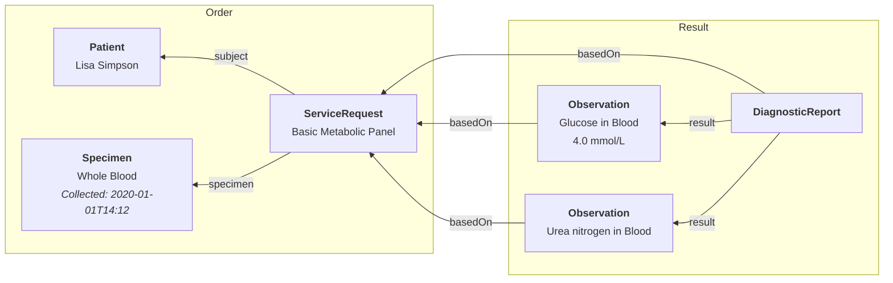

# Labs & Imaging

Lab orders and imaging results in FHIR follow a request-and-report pattern. A [`ServiceRequest`](/docs/api/fhir/resources/servicerequest) represents the order, and a [`DiagnosticReport`](/docs/api/fhir/resources/diagnosticreport) captures the results. Individual measurements are stored as [`Observation`](/docs/api/fhir/resources/observation) resources linked to the report.

## Key Resources

| **Resource**                                                    | **Description**                                                                                                               |
| --------------------------------------------------------------- | ----------------------------------------------------------------------------------------------------------------------------- |
| [`ServiceRequest`](/docs/api/fhir/resources/servicerequest)     | A record of an order for services such as diagnostic investigations, treatments, or operations to be performed.               |
| [`DiagnosticReport`](/docs/api/fhir/resources/diagnosticreport) | The findings and interpretations of diagnostic tests performed on a patient.                                                  |
| [`Specimen`](/docs/api/fhir/resources/specimen)                 | A record of a sample to be used for analysis.                                                                                 |
| [`Observation`](/docs/api/fhir/resources/observation)           | A structured representation of measurements and simple assertions made about a [`Patient`](/docs/api/fhir/resources/patient). |

## Key Code Systems

All codes come from KNHTS. See [Commonly used terminologies](/docs/terminology/common-terminologies).

| **Code System** | **Used for** |
| --- | --- |
| Kenyan investigations list (`MOH-PPB/Investigations`) | The test ordered on the [`ServiceRequest`](/docs/api/fhir/resources/servicerequest) |
| [LOINC](/docs/careplans/loinc) (`Regenstrief/LOINC` in KNHTS) | Tests and results on [`Observation`](/docs/api/fhir/resources/observation) resources |
| ICD-11 MMS | The diagnosis or reason for the order |
| [UCUM](https://ucum.org/) | Units of measurement on results and specimens |

## Afiax products and integrations

- [Laboratory orders and results](/docs/integration/laboratory): in-house analysers and external labs
- [Afiax DICOM](/docs/integration/afiax-dicom): imaging studies and radiology reports
- [Afiax Facility Agent](/docs/agent): connecting on-site equipment
